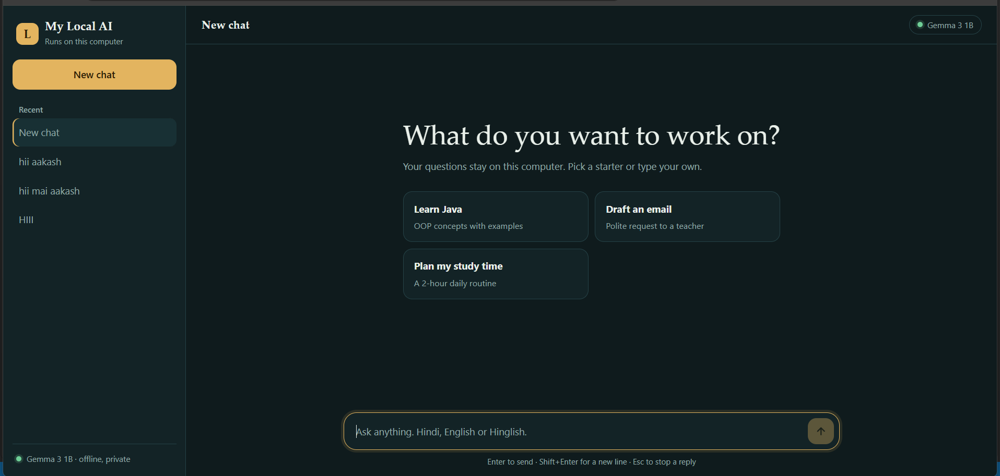

# 🤖 My Local AI

A personal AI assistant built using Python, Flask, and Ollama.

## 📸 Project Preview



## ✨ Features

- Chat with a local AI model
- Flask backend
- Simple web interface
- Local AI inference using Ollama
- Gemma 3 (1B) support

## 🛠️ Tech Stack

- Python
- Flask
- HTML, CSS, JavaScript
- Ollama

## 🚀 Run Locally

```bash
pip install -r requirements.txt
ollama pull gemma3:1b
python app.py
```

Open http://127.0.0.1:5000 in your browser.

## 👨‍💻 Author

Aakash Singh

GitHub: https://github.com/akash936924-cyber
